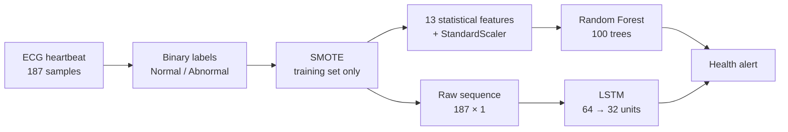
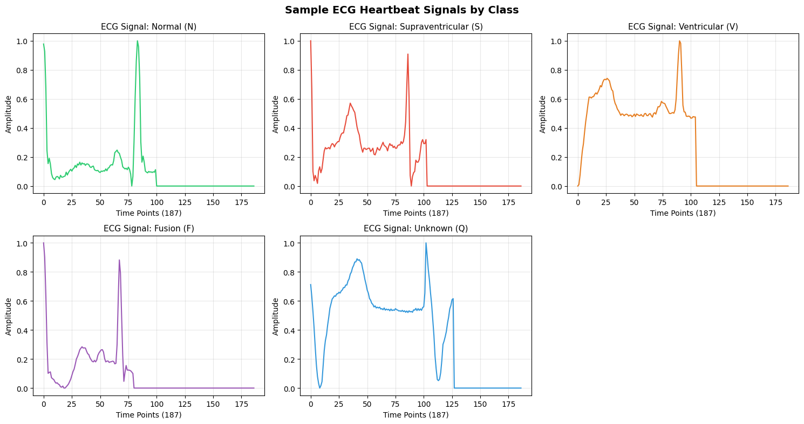
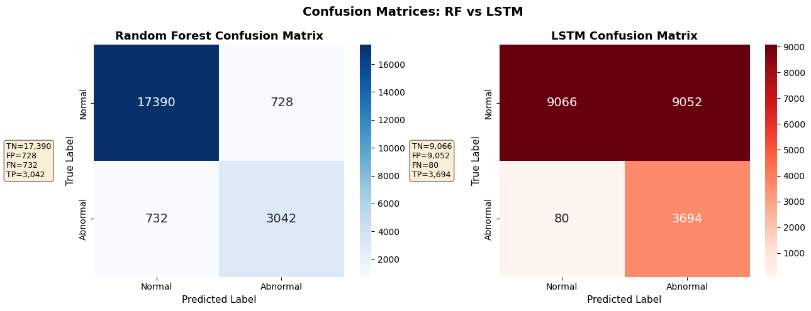
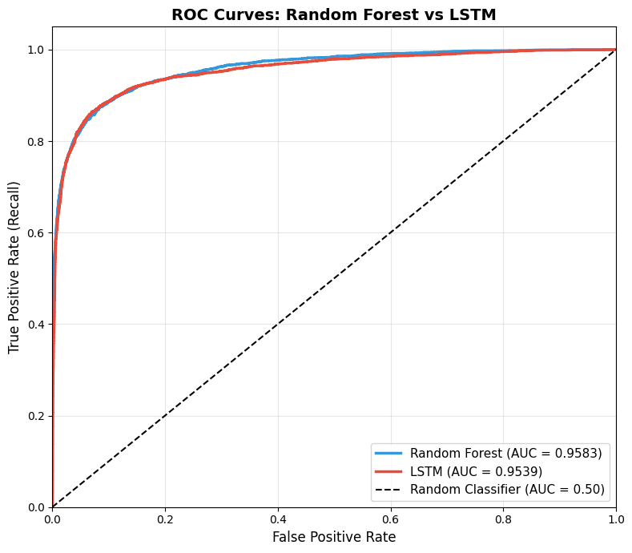
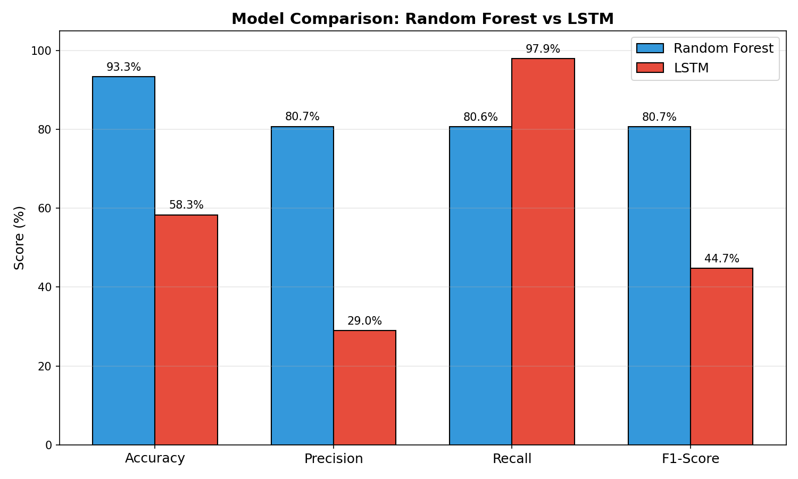
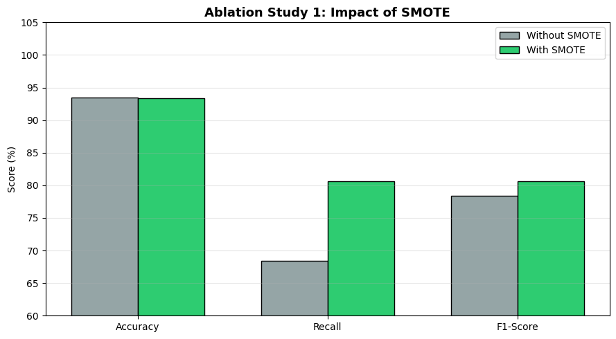
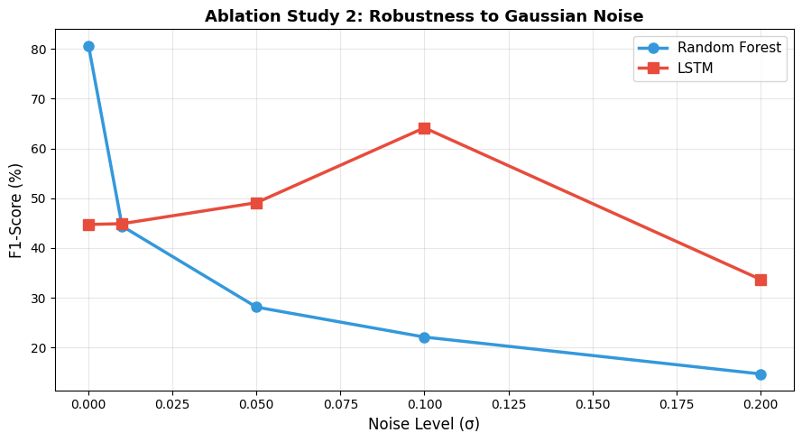

# Personalized Health Alerts for Preventive Care Using ECG Data

**A comparative study of Random Forest and LSTM for detecting abnormal heartbeats**

[](https://www.python.org/)
[](https://scikit-learn.org/)
[](https://www.tensorflow.org/)
[](LICENSE)

**Najma Nour, Haythem Elmessiry** · Department of Artificial Intelligence, Canadian University Dubai, UAE

📄 [Read the full report (PDF)](docs/report.pdf)

---

## Overview

Cardiovascular disease is the leading cause of death worldwide. Wearable ECG devices can watch the heart continuously. They are only useful if a model can tell, beat by beat, when something is wrong.

This project builds a binary **Normal vs Abnormal** heartbeat classifier on the MIT-BIH arrhythmia data and compares two approaches:

| | Random Forest | LSTM |
|---|---|---|
| **Input** | 13 statistical features per heartbeat | Raw 187-point ECG sequence |
| **Strength** | Fast and interpretable, fewer false alarms | Learns temporal patterns, catches more anomalies |

Abnormal beats make up only 17% of the training data, so **SMOTE** is used to balance the training set. Two ablation studies measure the effect of SMOTE and how robust each model is to sensor noise.

## Pipeline



## Dataset

[ECG Heartbeat Categorization Dataset](https://www.kaggle.com/datasets/shayanfazeli/heartbeat), a preprocessed version of the MIT-BIH Arrhythmia Database.

- **87,554** training and **21,892** test heartbeats, each with 187 amplitude values
- 5 original classes (N, S, V, F, Q), merged into **Normal (82.8%)** vs **Abnormal (17.2%)**
- After SMOTE, the training set is 72,471 heartbeats per class

<p align="center"></p>

See [`data/README.md`](data/README.md) for download instructions.

## Models

**Random Forest:** 100 trees, `max_depth=15`, `min_samples_split=4`, `max_features="sqrt"`, `class_weight="balanced"`. It is trained on 13 features per beat: mean, std, max, min, range, kurtosis, skewness, median, Q1, Q3, IQR, sum of absolute differences, and RMS.

**LSTM:** `LSTM(64) → BatchNorm → Dropout(0.3) → LSTM(32) → BatchNorm → Dropout(0.3) → Dense(16, ReLU) → Dropout(0.2) → Dense(1, sigmoid)`. It is trained with Adam (lr = 1e-3) and binary cross-entropy, with early stopping (patience 5) and ReduceLROnPlateau.

## Results

All results are on the held-out test set (21,892 heartbeats), using a decision threshold of 0.5. They come from the saved notebook run; the raw numbers are in [`results/metrics_notebook_run.json`](results/metrics_notebook_run.json).

| Metric | Random Forest | LSTM |
|---|---:|---:|
| Accuracy | **93.33%** | 58.29% |
| Precision | **80.69%** | 28.98% |
| Recall (sensitivity) | 80.60% | **97.88%** |
| F1-score | **80.65%** | 44.72% |
| ROC AUC | **0.958** | 0.954 |
| False negatives (missed abnormal beats) | 732 | **80** |
| False positives (false alarms) | **728** | 9,052 |
| Training time | **53 s** | 73 min |

<p align="center">
  
</p>
<p align="center">
  
  
</p>

### Key findings

- **The two models make different mistakes.** Random Forest balances precision and recall. The LSTM misses almost no abnormal beats (recall 97.9%) but raises about 9,000 false alarms at a threshold of 0.5.
- **Both models rank heartbeats about equally well.** Their ROC AUCs are close (0.958 vs 0.954). This means the LSTM's low precision comes mostly from its **decision threshold**, not from weak discrimination. Raising the threshold is the obvious next step against alarm fatigue.
- **SMOTE helps.** Random Forest recall on abnormal beats rises from 68.4% to 80.6% (+12.2 points), and accuracy stays almost the same.
- **Hand-crafted features are noise-sensitive.** Random Forest F1 falls from 80.7% to 44.4% with Gaussian noise of only σ = 0.01. The LSTM's F1 is more stable but low throughout.

<p align="center">
  
  
</p>

> **Note on the report:** The [report](docs/report.pdf) and poster give the same Random Forest numbers, but they come from a different LSTM training run: 83.85% accuracy, 51.69% precision, 96.42% recall, and 0.934 AUC. LSTM results vary from run to run, because SMOTE output, weight initialisation, and early stopping all affect the final model. The README reports the run whose code, outputs, and figures are all in this repository.

## Repository structure

```
ecg-health-alerts-rf-lstm/
├── ecg_alerts/                 # Reusable Python package
│   ├── data.py                 #   loading, binary labels, SMOTE
│   ├── features.py             #   13 statistical features
│   ├── models.py               #   Random Forest and LSTM definitions
│   └── evaluate.py             #   metrics
├── notebooks/
│   └── ecg_rf_vs_lstm.ipynb    # Full analysis: EDA, training, ablations
├── train.py                    # Command-line training script
├── data/                       # Dataset goes here (not tracked)
├── results/
│   ├── figures/                # Plots from the notebook run
│   └── metrics_notebook_run.json
├── docs/report.pdf             # Project report
├── requirements.txt
├── CITATION.cff
└── LICENSE
```

## Getting started

```bash
git clone https://github.com/Najma-Abdulkarim-Nor/ecg-health-alerts-rf-lstm.git
cd ecg-health-alerts-rf-lstm
python -m venv .venv
source .venv/bin/activate        # Windows: .venv\Scripts\activate
pip install -r requirements.txt
```

Download the dataset into `data/` (see [`data/README.md`](data/README.md)). Then either:

**Run the notebook**

```bash
jupyter notebook notebooks/ecg_rf_vs_lstm.ipynb
```

**Or train from the command line**

```bash
python train.py --skip-lstm      # Random Forest only, about 1 minute
python train.py                  # both models (the LSTM takes about 1 hour on CPU; a GPU is recommended)
python train.py --threshold 0.8  # try a stricter LSTM alert threshold
```

Metrics are written to `results/metrics.json`, and trained models to `results/models/`.

## Limitations and future work

- **Decision threshold:** tune the LSTM threshold, for example on a validation precision–recall curve, to cut false alarms.
- **Patient-level split:** the Kaggle split is by heartbeat, so beats from the same patient can appear in both train and test. An inter-patient split (de Chazal et al.) would give a more realistic estimate.
- **Noise robustness:** add noise augmentation during training, or features that hold up under noise.
- **Architectures:** CNN-LSTM hybrids, and attention for explaining LSTM decisions.
- **Explainability:** SHAP values for the Random Forest features.
- **Fairness:** MIT-BIH comes from 47 patients, so the model needs validating on more diverse groups.

## Ethical considerations

ECG signals are sensitive health data covered by HIPAA and GDPR. A real deployment needs encryption, consent, and privacy-preserving training such as federated learning. The precision–recall trade-off shown here is also a clinical one: missed anomalies put patients at risk, while too many false alerts lead to alarm fatigue.

> ⚠️ **Disclaimer:** This is a research and educational project. It is **not** a medical device and must not be used for clinical diagnosis.

## References

1. M. A. Morid, O. R. L. Sheng, J. Dunbar, "Time Series Prediction Using Deep Learning Methods in Healthcare," *ACM Trans. Manage. Inf. Syst.*, 2023.
2. D. Pavithra et al., "Application of LSTM Networks for Continuous Patient Monitoring and Anomaly Detection in Wearable Health Devices," *Indian J. Sci. Technol.*, 2024.
3. L. Afuan, R. R. Isnanto, "Enhanced Fall Detection using Optimized Random Forest Classifier on Wearable Sensor Data," *J. Appl. Data Sci.*, 2025.
4. L. Tan et al., "Toward Real-Time Cardiovascular Monitoring for COVID-19 Patients by 5G-Enabled Wearable Medical Devices," *Neural Comput. Appl.*, 2023.
5. A. Abedi et al., "AI-Driven Real-Time Monitoring of Cardiovascular Conditions With Wearable Devices: Scoping Review," *JMIR mHealth uHealth*, 2025.
6. N. V. Chawla et al., "SMOTE: Synthetic Minority Over-sampling Technique," *JAIR*, 2002.
7. M. Kachuee, S. Fazeli, M. Sarrafzadeh, "ECG Heartbeat Classification: A Deep Transferable Representation," *IEEE ICHI*, 2018.

## Citation

If you use this work, please cite it using the [`CITATION.cff`](CITATION.cff) file. On GitHub, click **"Cite this repository"**.

## License

Released under the [MIT License](LICENSE).
